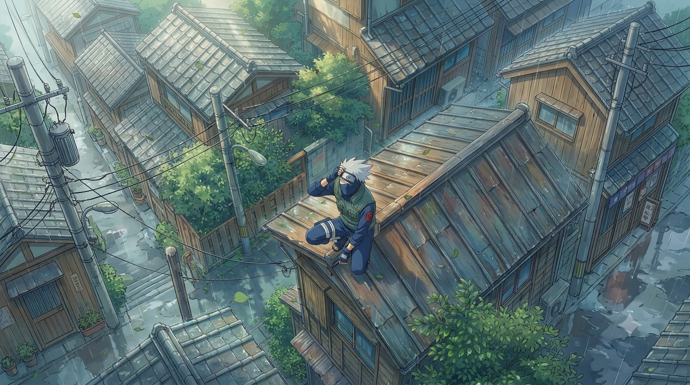
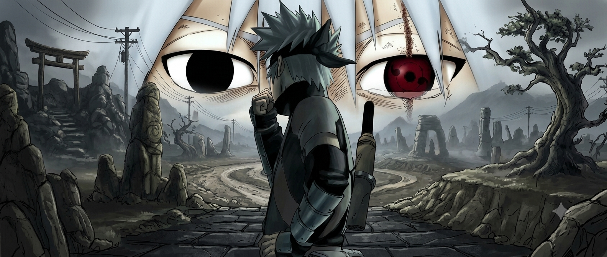

<!-- ============================================================
  KAKASHI HATAKE THEMED GITHUB PROFILE README
  Create a repo named exactly KAKASHI-CTRLC-CTRLV and save this as its README.md.
============================================================ -->

<!-- ===== ANIMATED HEADER (lightning blue + dark shinobi gradient) ===== -->
<p align="center">
  
</p>

<!-- ===== TYPING ANIMATION ===== -->
<p align="center">
  <a href="https://github.com/KAKASHI-CTRLC-CTRLV">
    
  </a>
</p>

<p align="center">
  
  
  
  
</p>

<p align="center">
  
</p>

---

<!-- ===== MY KAKASHI IMAGES =====
  Put your PNG files in a folder named "assets" in this repo.
  Rename them: kakashi1.png, kakashi2.png, kakashi3.png (all lowercase).
  Fewer images? Delete the extra  lines. More? Copy a line and use kakashi4.png, etc.
-->
<p align="center">
  
</p>


<details>
<summary align="center">👁️ <b>Click to open the Sharingan</b></summary>
<p align="center">
  
</p>
</details>

---

## 🥷 Ninja Profile

```ruby
class Shinobi
  attr_reader :name, :rank, :team, :motto

  def initialize
    @name  = "KAKASHI-CTRLC-CTRLV"
    @alias = "The Copy Ninja"
    @rank  = "Jonin (self-promoted)"
    @team  = "Team 7 (the one I never stop being proud of)"
    @eye   = "Sharingan 👁️  (left, obviously)"
    @hobbies = ["reading", "dogs", "anime", "gaming", "coding at 2AM"]
    @weakness = "being on time"
  end

  def motto
    "Teamwork over ego. Always."
  end
end
```

<details>
<summary>📜 <b>Open the scroll: more about me</b></summary>

<br>

- 📖 Currently reading: My engg. stuff
- 🎮 Currently playing: Minecraft,
- 🎧 Listening to: fuji kaze , wind 
- 🐶 Ninja hounds: want a cats so bad but mom said no T-T
- ⏰ Fun fact: WHEN I AM HUNGRY , I EAT ;)

</details>

---

## ⚡ Jutsu Arsenal (Tech Stack)

<p align="center">
  
</p>

| Jutsu | Rank | Chakra Level |
|:--|:--:|:--|
| 🔥 **Python Release: Automation** | B | ▰▰▰▰▰▰▰▰▱▱ |
| ⚡ **JavaScript: Lightning Blade** | A | ▰▰▰▰▰▰▰▱▱▱ |
| 💧 **Web Style: Water Layout (CSS)** | B | ▰▰▰▰▰▰▱▱▱▱ |
| 🌪️ **Git: Substitution Technique** | S | ▰▰▰▰▰▰▰▰▰▱ |
| 👁️ **Debugging: Sharingan Vision** | S | ▰▰▰▰▰▰▰▰▱▱ |

> Edit the table to match your real skills.

---

## 📊 Mission Report (GitHub Stats)

<p align="center">
  
  
</p>

<p align="center">
  
</p>

---

## 📈 Chakra Flow (Activity Graph)

<p align="center">
  
</p>

---

## 🏆 Trophies (Missions Cleared)

<p align="center">
  
</p>

---

## 🤝 Summon Me

<p align="center">
  <a href="https://github.com/KAKASHI-CTRLC-CTRLV"></a>
  <a href="https://instagram.com/Bhanu_chandra_007"></a>
  <a href="https://discord.com/users/bhanuchandras"></a>
  <a href="mailto:YOUR_EMAIL"></a>
</p>

<p align="center">
  
</p>


